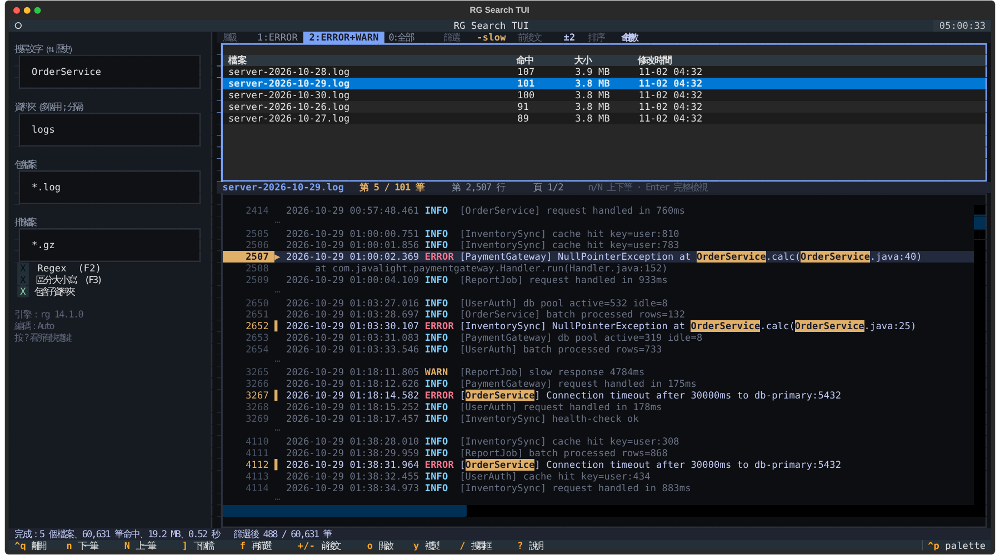

# RG Search GUI

這是一個以 Python 與 Tkinter 製作的桌面全文搜尋工具，主要目標是讓你不用一直切回終端機，也能快速跨多個資料夾搜尋文字內容。
維護者：`Javalight`
這是一個獨立開發的 GUI 工具，與 `ripgrep` 專案無官方隸屬、合作或背書關係。

English README: [../../README.md](../../README.md)

## 這個專案在做什麼

- 支援多資料夾搜尋
- 支援 include / exclude pattern
- 支援大小寫敏感與 regex
- 支援搜尋中即時串流顯示結果
- 支援命中內容預覽與簡單語法高亮
- 主畫面採用接近 VS Code 的左右工作區配置
- Windows 下若缺少 `rg`，可在 GUI 內提示安裝並顯示安裝日誌

## 執行方式

### 方式 1：安裝後啟動

```bash
pip install -e .
rg-search-gui
```

### 方式 2：直接以模組啟動

```bash
python -m rg_search_gui
```

### 方式 3：Windows 啟動器

直接執行 `run_rg_search_gui.bat`
這個啟動器不會綁死本機 `C:\...` Python 路徑，會先嘗試 `py`，再嘗試 `PATH` 內的 `python`

### 方式 4：終端機版（TUI）

不想開視窗、或要在遠端主機上查 log，可以用終端機版。搜尋核心跟 GUI 共用，版面是左邊搜尋條件、右上檔案清單、右下命中預覽，全程鍵盤操作，適合幾十萬到幾百萬行的 log。



```bash
pip install -e .[tui]        # 或：pip install -r requirements.txt
rg-search-tui D:\logs -q timeout -g "*.log"
```

Windows 也可以直接執行 `run_rg_search_tui.bat D:\logs -q timeout`（第一次會自動安裝 `textual`）。

| 按鍵 | 功能 |
|---|---|
| `Enter`（搜尋框） | 開始搜尋；`↑` / `↓` 叫回最近 20 次搜尋 |
| `n` / `N` | 下一筆 / 上一筆命中（會跨檔案） |
| `]` / `[` | 下一個 / 上一個檔案 |
| `1` / `2` / `0` | 只看 ERROR / ERROR+WARN / 全部 |
| `f` | 在結果裡再篩：空白分隔多個字，`-字` 表示排除 |
| `+` / `-` | 前後文 0、2、5、10、20 行 |
| `Enter`（檔案清單） | 完整檢視：以命中行為中心看原檔，Esc 返回 |
| `s` | 檔案排序：命中數、檔名、修改時間 |
| `o` / `y` / `e` | 用 VS Code 開到那一行 / 複製命中與前後文 / 匯出篩選後結果成 `.log` |
| `Esc` | 停止搜尋 |
| `Ctrl+B` / `?` | 收起側欄 / 顯示所有快捷鍵 |

沒有 `rg` 時會改用 Python 搜尋（大量 log 會很慢）。編碼預設 `Auto`，預覽會自動判斷 Big5（cp950），中文關鍵字也會再用 Big5 搜一次。

## 需求

- Python 3.10 以上
- Windows 為主要目標環境
- 建議安裝 `ripgrep (rg)` 以獲得最佳搜尋效能

## 專案定位

這個專案目前適合作為公開 MVP：

- 原始碼清楚
- 功能聚焦在搜尋主線
- 可直接本機執行
- 沒有過度框架化

如果之後要擴大受眾，可以再補 GitHub Releases 的 `.exe` 版本。

## 補充文件

- 英文首頁文件：[../../README.md](../../README.md)
- 英文操作手冊：[../user-guide.md](../user-guide.md)
- 操作手冊：[usage-guide.md](usage-guide.md)
- 歷史整理文件 / 原始碼參考：[rg-search-gui-spec.md](rg-search-gui-spec.md)
- 版本記錄：[../../CHANGELOG.md](../../CHANGELOG.md)

## 授權

本專案採用 MIT License。
白話來說，別人可以使用、修改、散布這個專案，但必須保留原本的授權聲明。

## 貢獻

如果你要提 issue 或 PR，請先看 [../../CONTRIBUTING.md](../../CONTRIBUTING.md)。
